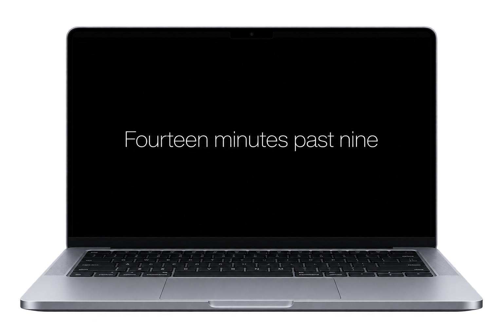

[](icon.png)

# Wordclock

A macOS screen saver that tells the time in words — not `21:14`, but “Fourteen minutes past nine”.

[](https://github.com/artdima/verbarius/actions/workflows/ci.yml)
[](https://www.apple.com/macos/)
[](https://swift.org)
[](https://developer.apple.com/xcode/swiftui/)
[](#architecture)
[](LICENSE)

Every minute of the day has its own set of phrasings, up to eleven of them, stored in
`English.json` and `Russian.json`. The saver picks one per minute and crossfades to the next.

## Options

| Setting | What it does |
| -------------------- | ----------------------------------------------------------------- |
| **Language** | Russian or English phrasings; follows the system language until you choose |
| **Vary the wording** | A different phrasing every minute instead of always the first one |
| **Shift the text** | Slowly drifts the text across the screen to spare the display |
| **Text size** | Scales the type from 50 % to 160 % |

The settings sheet itself is in English and Russian.

## Install

**From a release.** Download `Wordclock-x.y.saver.zip` from
[Releases](https://github.com/artdima/verbarius/releases), unzip it and double-click
`WordclockScreenSaver.saver` — System Settings offers to install it. The bundle is signed with a
Developer ID and notarized, so Gatekeeper lets it through.

**From source.**

1. Open `WordclockScreenSaver.xcodeproj` in Xcode and build it (⌘B). The project signs ad hoc
   (“Sign to Run Locally”), so no Apple developer account is needed.
2. `Products → WordclockScreenSaver.saver → Show in Finder`, then double-click it or
   copy it into `~/Library/Screen Savers/`.
3. `System Settings → Screen Saver → Wordclock`, the **Options** button opens the table above.

After a rebuild copy the saver again and restart System Settings — `legacyScreenSaver`
caches the bundle, `killall legacyScreenSaver` helps.

## Architecture

```
WordclockScreenSaverView.swift   ScreenSaverView: hosts SwiftUI, owns the configure sheet
ClockEngine.swift                half-second tick, phrase for the current minute, drift
ClockLibrary.swift               JSON parsing: value_1…value_N → array of options
ClockScreen.swift                full-screen text layout
ConfigureView.swift              settings window
Settings.swift                   settings in ScreenSaverDefaults
Localizable.xcstrings            settings window strings, en + ru
scripts/validate_phrases.py      checks both JSON files; runs in CI
scripts/release.sh               Developer ID build, notarization, stapling
```

Around 390 lines of Swift and two JSON files, no dependencies. The engine holds no view
and the view holds no clock: `ClockEngine` publishes a phrase, an offset and the current
settings, `ClockScreen` draws them.

## Decisions worth explaining

**Resources load through `Bundle(for:)`, not `Bundle.main`.** Since macOS 14 a saver runs
inside `legacyScreenSaver`, and `Bundle.main` is that process — the JSON would not be found.
The same goes for the strings in the settings sheet: every `Text` is given the saver's bundle
explicitly, otherwise SwiftUI looks the key up in the host and shows it untranslated.

**The time key comes from `Calendar.autoupdatingCurrent`, not a `DateFormatter`.** A formatter
follows the 12-hour setting of the system (`09:41 AM` matches nothing in the JSON) and freezes
the time zone it was created with, while `legacyScreenSaver` can live for days.

**The phrasing is derived from the minute number, not drawn at random.** Every display
shows the same wording at the same time, and a re-tick inside the minute never swaps the
text mid-sentence.

**`value_1…value_N` is decoded with a dynamic coding key.** The number of options varies
from minute to minute; a fixed `CodingKeys` set would be as wide as the widest entry and
optional almost everywhere. Values are trimmed and blanks dropped, so a stray `" "` in the
data cannot produce an empty screen.

**The project signs ad hoc; Developer ID lives only in `scripts/release.sh`.** Anyone can
clone and build without certificates, and the release build is a single script that signs
with the hardened runtime, notarizes and staples.

**Phrases are checked, not trusted.** `scripts/validate_phrases.py` verifies that both files
cover all 1440 minutes, contain no blanks or duplicates, and that every phrase names the
minute it belongs to — including the hour after “to” and the a.m./p.m. suffix, which follows
the current hour: 11:17 is “forty-three minutes to twelve a.m.”.

Notes in Russian on the file layout and the macOS 14 pitfalls are in
[`WordclockScreenSaver/README.md`](WordclockScreenSaver/README.md).

## Release

```sh
xcrun notarytool store-credentials wordclock --apple-id <id> --team-id <TEAM> --password <app-specific>
WORDCLOCK_TEAM_ID=<TEAM> scripts/release.sh
```

The script builds Release with `Developer ID Application`, notarizes the zip, staples the
bundle and writes `dist/Wordclock-<version>.saver.zip` with its SHA-256. Bump
`MARKETING_VERSION` in the project before running it.

## About the idea

Made after the **Verbarius** clock designed at
[Art. Lebedev Studio](https://www.artlebedev.ru) — an amateur implementation of the idea
itself, written from scratch and not used commercially. The project is not affiliated
with the studio and is not their product; the name, the original design and its firmware
belong to them. If you are a rights holder and believe anything here infringes on your
rights, get in touch and it will be removed.

## License

MIT — take it and use it. See [LICENSE](LICENSE).
